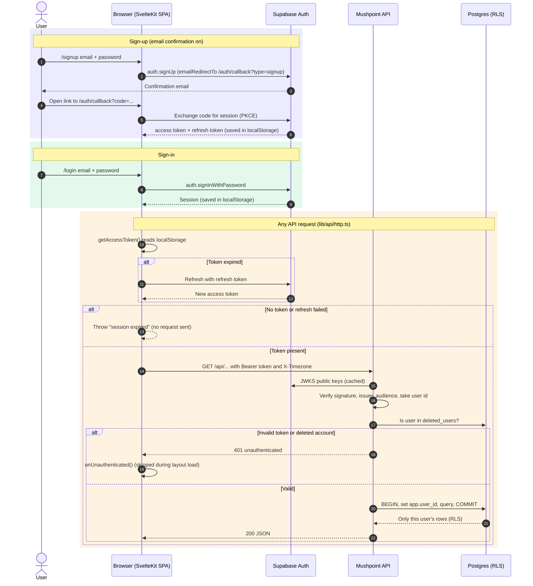
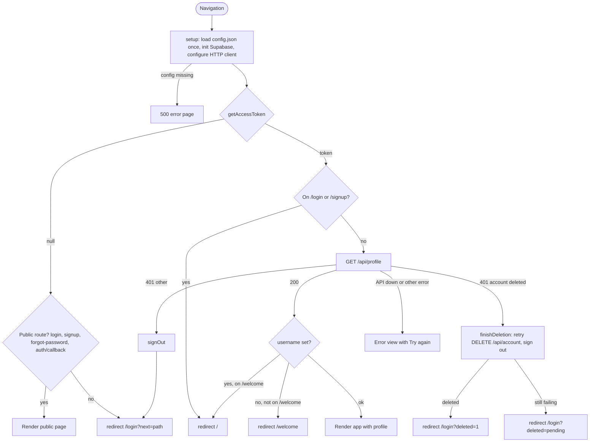

# Mushpoint web client

Mushpoint is a goal tracker. This folder holds its web client: a SvelteKit single-page app (SPA) styled with Tailwind v4. All data lives behind the Mushpoint API in [`../server`](../server/README.md), and this app talks to it only over HTTP. Sign-in runs in the browser against Supabase.

The plan of record is [`../docs/plans/goal_tracker_plan.md`](../docs/plans/goal_tracker_plan.md). The last desktop version (Tauri and SQLite) is tagged `desktop-sqlite-final`.

## Run the client locally

You need the API running and a Supabase project before the client can sign you in.

1. Copy `static/config.example.json` to `static/config.json`. Git ignores the copy.
2. Fill in your Supabase project URL and anon key. Leave `apiUrl` as `/api`.
3. Start the API as described in [`../server/README.md`](../server/README.md). It listens on port 3000.
4. Install dependencies and start the dev server:

```sh
npm install
npm run dev
```

The app runs on `http://localhost:5173`. The Vite dev server forwards every `/api` request to the API on port 3000.

The `config.json` values are safe to ship to the browser. The anon key only allows what an anonymous visitor can do. Never put the Supabase service key in this file.

### Configure Supabase sign-in

Sign-in uses Supabase email and password with the Proof Key for Code Exchange (PKCE) flow. In the Supabase dashboard, open **Authentication** and set:

- **Sign In / Providers, Email**: turn on **Confirm email** and **Secure email change**
- **URL Configuration, Redirect URLs**: add `http://localhost:5173/auth/callback` for dev, `http://localhost:4173/auth/callback` for preview, and your deployed origin's `/auth/callback`

Every email link lands on `/auth/callback`, which exchanges the code in the link for a session. That covers sign-up confirmation, password reset, and email change. PKCE ties each link to the browser that requested it, so open the link in that same browser.

## Test the client

The client has unit tests, a type check, and an end-to-end suite. Run them with:

```sh
npm run test:unit     # Vitest in watch mode
npm run test          # Vitest, run once
npm run check         # svelte-check
npm run test:e2e      # Playwright, needs the setup below
```

Unit tests cover client logic and the API client with HTTP mocked.

### Run the end-to-end tests

The end-to-end suite drives the built app against the real API and a real Supabase project. It creates 2 throwaway users, `e2e-a-<run_id>@example.com` and `e2e-b-<run_id>@example.com`, and deletes them afterwards, even when a test fails.

1. Fill in `static/config.json` and `../server/.env` for the same Supabase project. See [`../server/README.md`](../server/README.md).
2. Start and migrate the server's database: run `npm run db:up`, then `npm run migrate`, in `../server`.
3. Copy `.env.e2e.example` to `.env.e2e`.
4. Fill in `E2E_SUPABASE_URL`, `E2E_SUPABASE_SERVICE_KEY`, and `E2E_PASSWORD` for that same project.
5. Run `npm run test:e2e`.

Playwright starts the API with `npm --prefix ../server run dev`, or reuses one already on port 3000. It then builds the app and previews it on port 4173. Without `.env.e2e`, the run stops at once and names the missing variables.

### Check email flows by hand

The end-to-end run confirms users through the admin API and never opens an email. Before a release, check these flows by hand against a real Supabase project:

1. **Sign up with real email confirmation**: sign up with an inbox you can read, open the confirmation link in the same browser, and pick a username. You should land signed in.
2. **Password reset**: click **Forgot password** on `/login`, open the emailed link, and set a new password. Sign in with the new password, then confirm the old one fails.
3. **Email change**: change the email in **Settings**. The pending address shows as waiting for confirmation. Confirm from both inboxes, then sign in with the new address.
4. **Delete account**: in **Settings**, the confirm button stays disabled until you type the account email. Deleting lands on `/login` with “Your account was deleted.” The old credentials no longer sign in.
5. **Reload a signed-in page**: on `/goals`, `/tasks`, and `/settings`, reload and open the page in a new tab. Each page loads its data without an error banner.

## How sign-in reaches the API

The browser signs in against Supabase and sends the resulting access token to the API on every request. The API verifies the token against Supabase's published signing keys (JSON Web Key Set, or JWKS). It then limits every query to that user with Postgres row-level security (RLS).

### Sign-up, sign-in, and an API request

This diagram follows a new user from sign-up to their first API response:



The numbered steps are explained in detail in [`docs/auth.md`](../docs/auth.md):

- **Steps 4 to 6, the email link**: [Email links and the PKCE callback](../docs/auth.md#email-links-and-the-pkce-callback)
- **Steps 10 to 13, the token**: [Getting and refreshing the access token](../docs/auth.md#getting-and-refreshing-the-access-token)
- **Steps 14 to 16, verification**: [Verifying the token on the server](../docs/auth.md#verifying-the-token-on-the-server)
- **Step 17, the `deleted_users` check**: [Deleting an account](../docs/auth.md#deleting-an-account)
- **Steps 18 and 19, a refused token**: [Handling a 401 in the browser](../docs/auth.md#handling-a-401-in-the-browser)
- **Steps 20 and 21, per-user rows**: [Scoping queries with row-level security](../docs/auth.md#scoping-queries-with-row-level-security)

### Route guard on every navigation

The root layout load in `src/routes/+layout.ts` decides where each navigation ends up:



These parts of the flowchart are explained in detail in [`docs/auth.md`](../docs/auth.md):

- **The whole guard, and the `401 other` branch**: [Handling a 401 in the browser](../docs/auth.md#handling-a-401-in-the-browser)
- **The `finishDeletion` branch**: [Deleting an account](../docs/auth.md#deleting-an-account)

A few details the diagrams leave out:

- **Parallel page loads**: SvelteKit runs page loads alongside this guard. When you're signed out, their requests fail inside `request()` before any network call, and the guard's redirect wins.
- **Token checks**: the browser only checks that a token exists and hasn't expired. The API is what proves the token genuine.
- **Callback types**: password reset and email change return through the same `/auth/callback` route, with `type=recovery` and `type=email_change`.

## Project layout

Each folder under `src` has one job:

```text
src/lib/auth/         Supabase session (sign-in, callback, token) and public-route rules
src/lib/api/          the one interface routes/components use; one HTTP call per function
src/lib/images.ts     vision image upload (type/size checked before it is sent)
src/lib/theme/        active theme store, persisted via the API and mirrored to localStorage
src/lib/icons/        logical icon names resolved per theme
src/lib/components/   UI components
src/routes/           one folder per screen
static/config.json    runtime config (API base URL, Supabase project), loaded at startup
```

## Behavior worth knowing

These rules shape how the screens behave and aren't obvious from the UI:

- **Progress is calcuated**: a goal averages its direct children. Subgoals and directly linked tasks weigh the same, and a subgoal's own value is the average of its tasks. A task counts only when `done`; `in_progress` counts as 0.
- **Status is separate from progress**: completing or archiving a goal is an explicit user action, so progress can sit at 100% while the goal stays active.
- **Images go through the server**: the client uploads images of up to 5&nbsp;MB to the server, which stores them and returns a signed URL that expires after 1 hour. The server also removes an image when its vision item drops or replaces it, so the client never deletes files.
- **Themes come from the design package**: themes are CSS custom properties from `mushpoint-design/css/theme.css`, imported in `src/routes/layout.css`, and mapped to Tailwind utilities such as `bg-surface` and `text-muted`. To add a theme, add it to the design package, add one entry to `THEMES` in `src/lib/theme/theme.svelte.ts`, and add one to the server's allow-list. Components must not hardcode colors.
